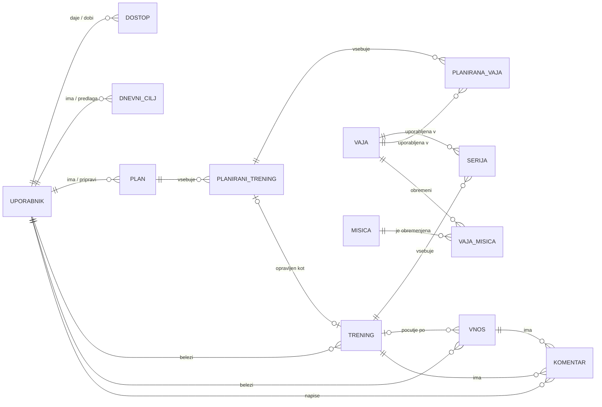
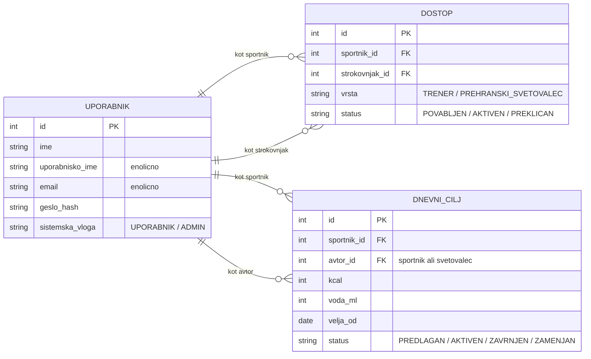
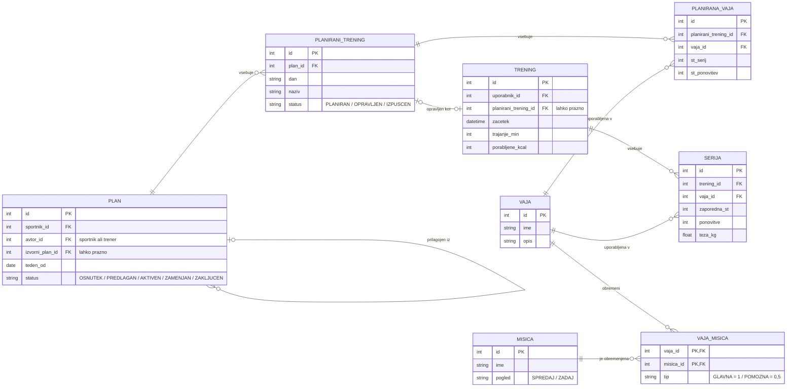
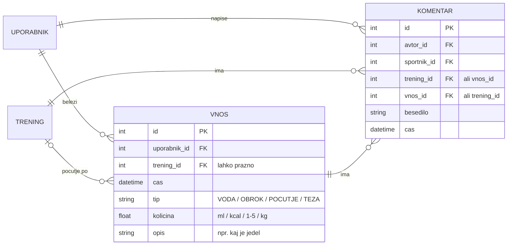

# Podatkovni model

Uporabljena bo relacijska podatkovna baza (PostgreSQL), ker so podatki med seboj močno povezani (uporabnik → trening → serija → vaja → mišica) in ker imajo dostopi, plani in cilji stanja, ki jih mora baza zanesljivo hraniti.

## Entitete in glavna polja

| Entiteta | Glavna polja | Opis |
| --- | --- | --- |
| **Uporabnik** | id, ime, uporabnisko_ime, email, geslo_hash, sistemska_vloga (UPORABNIK / ADMIN), ustvarjen | Vsak uporabnik je športnik. Vlogi trenerja in prehranskega svetovalca nista zapisani tukaj, ampak izhajata iz tabele Dostop. |
| **Dostop** | id, sportnik_id, strokovnjak_id, vrsta (TRENER / PREHRANSKI_SVETOVALEC), status (POVABLJEN / AKTIVEN / PREKLICAN), ustvarjen | Kdo ima dostop do športnikovih podatkov in v kateri vlogi. Če je ista oseba trener in svetovalec, ima dve vrstici. Podatke vidi samo, ko je status AKTIVEN. |
| **Vaja** | id, ime, opis | Seznam vaj, ki ga ureja administrator. |
| **Misica** | id, ime, pogled (SPREDAJ / ZADAJ) | V MVP so to večje mišične skupine (npr. prsa, biceps, kvadriceps), ki se prikažejo na zemljevidu mišic. |
| **VajaMisica** | vaja_id, misica_id, tip (GLAVNA / POMOZNA) | Katere mišice vaja obremeni. Glavna šteje 1, pomožna 0,5. |
| **Plan** | id, sportnik_id, avtor_id, izvorni_plan_id (lahko prazno), teden_od, status (OSNUTEK / PREDLAGAN / AKTIVEN / ZAMENJAN / ZAKLJUCEN), opomba | Tedenski plan. Avtor je športnik sam ali trener. Ko športnik prilagodi trenerjev predlog, nastane nov plan, ki kaže na izvorni predlog (izvorni_plan_id), predlog pa dobi status ZAMENJAN. Tako trener vidi obe različici. |
| **PlaniraniTrening** | id, plan_id, dan, naziv, status (PLANIRAN / OPRAVLJEN / IZPUSCEN) | En trening v planu (npr. »ponedeljek – noge«). |
| **PlaniranaVaja** | id, planirani_trening_id, vaja_id, st_serij, st_ponovitev | Katere vaje naj športnik naredi na planiranem treningu. |
| **Trening** | id, uporabnik_id, planirani_trening_id (lahko prazno), zacetek, trajanje_min, porabljene_kcal, opomba | Dejansko opravljen trening. Če je bil po planu, je povezan s planiranim treningom. Porabljene kalorije v MVP vnese športnik. |
| **Serija** | id, trening_id, vaja_id, zaporedna_st, ponovitve, teza_kg | Ena serija vaje na treningu. Iz serij se računa zemljevid mišic. |
| **Vnos** | id, uporabnik_id, trening_id (lahko prazno), cas, tip (VODA / OBROK / POCUTJE / TEZA), kolicina, opis | En vnos na časovnici: voda (ml), obrok (ocenjene kcal + besedni opis, kaj je športnik jedel), počutje (1–5) ali teža (kg). Počutje je lahko vezano na trening (trening_id) ali na poljuben del dneva. |
| **DnevniCilj** | id, sportnik_id, avtor_id, kcal, voda_ml, velja_od, status (PREDLAGAN / AKTIVEN / ZAVRNJEN / ZAMENJAN) | Dnevni cilj kalorij in vode. Avtor je športnik sam ali prehranski svetovalec. Športnikov cilj je takoj AKTIVEN, svetovalčev je PREDLAGAN, dokler ga športnik ne sprejme ali zavrne. Ko začne veljati nov cilj, stari dobi status ZAMENJAN. Ker se stari cilji hranijo, grafi za pretekle dni primerjajo vnos s ciljem, ki je veljal tisti dan. |
| **Komentar** | id, avtor_id, sportnik_id, trening_id (lahko prazno), vnos_id (lahko prazno), besedilo, cas | Komentar trenerja ali prehranskega svetovalca na trening ali vnos na časovnici. Izpolnjeno je natanko eno od polj trening_id in vnos_id. |

## Povezave med entitetami

- Uporabnik 1 : N Trening, Uporabnik 1 : N Vnos
- Uporabnik (športnik) 1 : N Dostop N : 1 Uporabnik (strokovnjak)
- Vaja N : M Misica (preko VajaMisica)
- Trening 1 : N Serija, Serija N : 1 Vaja
- Uporabnik 1 : N Plan (kot športnik) in 1 : N Plan (kot avtor)
- Plan 0..1 : N Plan (prilagojeni plan kaže na izvorni predlog)
- Plan 1 : N PlaniraniTrening 1 : N PlaniranaVaja N : 1 Vaja
- PlaniraniTrening 1 : 0..1 Trening
- Uporabnik 1 : N DnevniCilj (kot športnik in kot avtor)
- Trening 1 : N Vnos (počutje po treningu)
- Trening 1 : N Komentar, Vnos 1 : N Komentar

## Stanja (delovni proces)

| Entiteta | Stanja | Kdo spremeni stanje |
| --- | --- | --- |
| Dostop | POVABLJEN → AKTIVEN → PREKLICAN | športnik povabi, povabljeni sprejme, športnik prekliče |
| Plan (trenerjev predlog) | OSNUTEK → PREDLAGAN → AKTIVEN (sprejet) ali ZAMENJAN (prilagojen) | trener pripravi in predlaga, športnik sprejme ali prilagodi |
| Plan (športnikov ali prilagojen) | OSNUTEK → AKTIVEN → ZAKLJUCEN | športnik; ob koncu tedna sistem |
| PlaniraniTrening | PLANIRAN → OPRAVLJEN ali IZPUSCEN | športnik |
| DnevniCilj | PREDLAGAN → AKTIVEN ali ZAVRNJEN; AKTIVEN → ZAMENJAN | svetovalec predlaga, športnik sprejme ali zavrne; ob novem cilju sistem |

## Razširitev za podrobnejši model telesa (kasnejša nadgradnja)

Ko bo model telesa podrobnejši, bo vsaka mišica posamezna mišica, administrator pa jih bo združeval v večje skupine. Dodana bo ena tabela in eno polje:

| Entiteta | Glavna polja | Opis |
| --- | --- | --- |
| **MisicnaSkupina** | id, ime | Večja skupina mišic (npr. prsa, hrbet, noge). |
| **Misica** (dodano polje) | skupina_id | V katero skupino spada mišica. |

Struktura tabel VajaMisica in Serija se ne spremeni; administrator mora le pri vajah namesto skupin določiti posamezne mišice. Zemljevid mišic lahko vrednosti sešteje po skupinah ali jih prikaže za vsako mišico posebej.

## Osnutek podatkovnega modela

Model je zaradi preglednosti prikazan v štirih delih: najprej pregled vseh entitet in povezav, nato vsak sklop posebej s polji. Oznaki PK (primarni ključ) in FK (tuji ključ) povesta, kako so tabele povezane.

### Pregled

### 1. Uporabniki in dostop

### 2. Plani, treningi in mišice

### 3. Časovnica in komentarji

