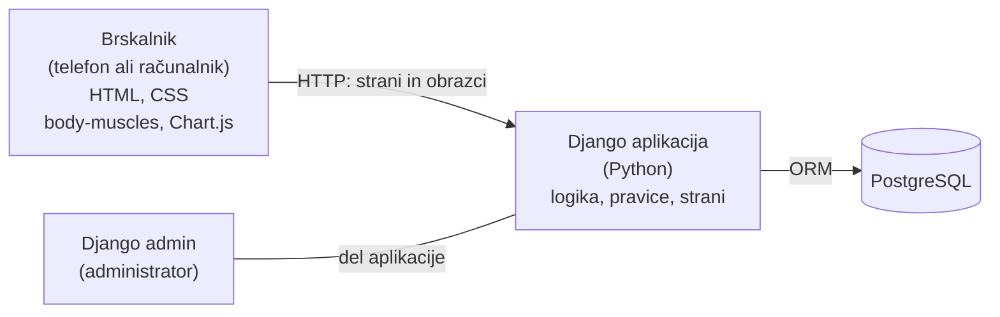

# Arhitektura in tehnološki sklad

## Arhitektura

### Glavni deli sistema

- **Spletna aplikacija (Django)** – ena aplikacija, ki vsebuje vso logiko (pravice dostopa, stanja dostopov in planov, časovnica, izračun zemljevida mišic in dnevnih ciljev) in sestavi strani, ki jih vidi uporabnik.
- **Brskalnik** – prikaže strani, ki so prilagojene tudi za telefon. Manjši del JavaScripta nariše zemljevid mišic in grafe.
- **Podatkovna baza** – PostgreSQL, hrani vse podatke (glej `03-podatkovni-model.md`).
- **Administracija** – vgrajen Django admin, v katerem administrator ureja vaje, mišice in uporabniške račune.

### Komunikacija med deli

- Brskalnik in Django komunicirata prek HTTP: uporabnik odpre stran ali odda obrazec, Django vrne novo stran.
- Podatke za zemljevid mišic in grafe Django izračuna in jih vstavi v stran, JavaScript jih nato samo nariše.
- Django do baze dostopa prek svojega ORM-ja. Brskalnik do baze nima neposrednega dostopa.

### Podatkovna baza

PostgreSQL – relacijska baza, ki teče kot ločen strežnik. Django se nanjo poveže z gonilnikom `psycopg`. Tabele se ustvarijo z Django migracijami, zato ima vsak razvijalec enako bazo.

### Avtentikacija in upravljanje uporabnikov

- Uporabljen je vgrajen Django sistem za uporabnike: registracija, prijava z uporabniškim imenom in geslom, seja po prijavi. Za prijavo z e-pošto se doda manjša dopolnitev (lasten način preverjanja prijave). Gesla Django shrani samo kot zgoščene vrednosti.
- Administrator (v podatkovnem modelu `sistemska_vloga = ADMIN`) ima dostop do Django admina. V adminu so na voljo samo vaje, mišice in uporabniški računi, podatki o treningih in prehrani pa ne.
- Django pri vsaki zahtevi preveri pravice:
  - lastne podatke lahko bere in ureja samo lastnik,
  - podatke drugega uporabnika lahko bere samo uporabnik z AKTIVNIM dostopom do tega športnika, in sicer samo podatke, ki spadajo k vrsti dostopa (TRENER: treningi, serije, plani, počutje, teža; PREHRANSKI_SVETOVALEC: vnos kalorij in vode, porabljene kalorije na treningih, cilji, počutje, teža),
  - trenerjev predlog plana lahko ureja samo trener, dokler ni sprejet ali prilagojen.

### Lokalni zagon

Potrebna sta Python in PostgreSQL. V PostgreSQL se najprej ustvari prazna baza (npr. `karrabimzagym`), podatki za povezavo (ime baze, uporabnik, geslo) pa se vpišejo v datoteko `.env` po vzoru `.env.example`.

```bash
git clone <repozitorij>
cd karrabimzagym
python -m venv venv
venv\Scripts\activate            # Windows (Linux/macOS: source venv/bin/activate)
pip install -r requirements.txt
copy .env.example .env           # Windows (Linux/macOS: cp); vpiši podatke za bazo
python manage.py migrate         # ustvari tabele
python manage.py loaddata zacetni_podatki.json   # vaje, mišice in testni uporabniki
python manage.py runserver
```

Aplikacija teče na `http://127.0.0.1:8000`, administracija na `http://127.0.0.1:8000/admin`.

### Diagram



## Tehnološki sklad

| Del | Tehnologije in orodja |
| --- | --- |
| Frontend | Django predloge (HTML, CSS), JavaScript knjižnici `body-muscles` (zemljevid mišic) in Chart.js (grafi) |
| Backend | Python, Django |
| Podatkovna baza | PostgreSQL (gonilnik `psycopg`) |
| Avtentikacija | vgrajen Django sistem za uporabnike |
| Lokalni razvoj | Python, lokalno nameščen PostgreSQL, Git in GitHub |
| Drugo | Django admin za administratorja |

Navedene so samo tehnologije, ki so potrebne za MVP. Druga orodja (npr. za izgled strani) se dodajo, ko bodo res potrebna.


## Arhitekturne odločitve

- **Django namesto ločenega frontenda in backenda.** Ena aplikacija v enem jeziku je za ta obseg dovolj in je enostavnejša za razvoj. Django ima že vgrajene uporabnike, prijavo, delo z bazo, migracije in administracijo, zato tega ni treba pisati na novo.
- **PostgreSQL.** Podatki so povezani in imajo stanja, zato je primerna relacijska baza. PostgreSQL je samostojen strežnik, kot bi ga aplikacija uporabljala tudi v resničnem okolju, Django pa ga podpira brez dodatnih orodij (samo gonilnik).
- **Dnevni cilji v svoji tabeli.** Cilji se s časom spreminjajo. Ker se stari cilji hranijo, je napredek za pretekle dni prikazan glede na cilj, ki je takrat veljal. Svetovalčev predlog je ista tabela s stanjem PREDLAGAN.
- **Trener in prehranski svetovalec nista posebni vrsti računa, ampak dostop med dvema uporabnikoma.** Ista oseba je lahko športnik, trener in svetovalec, pravice pa se preverjajo po vrsti in stanju dostopa.
- **Prilagojen plan je nova različica, ne sprememba predloga.** Trenerjev predlog ostane shranjen, zato lahko trener primerja svoj predlog s tem, kar je športnik spremenil.
- **Zemljevid mišic računa Django, nariše ga knjižnica.** Django za izbrano obdobje sešteje serije po mišicah (glavna mišica 1, pomožna 0,5) in jih preračuna na lestvico 0–10, ki jo uporablja knjižnica. Primerjavo dveh različic plana prav tako izračuna Django. Knjižnica `body-muscles` (licenca Apache 2.0) deluje z navadnim JavaScriptom, ima pogled spredaj in zadaj, barvno lestvico intenzivnosti ter že 70+ mišic in imenovane skupine mišic, zato je pripravljena tudi za kasnejši podrobnejši model telesa.
- **Obrok kot besedni opis z oceno kalorij.** Vnos je hiter in ne potrebuje baze živil, ki je velik dodaten del; ta je med kasnejšimi nadgradnjami.
- **Možnost nadaljnjega razvoja.** Za kasnejšo mobilno aplikacijo se lahko Djangu doda REST API, obstoječa logika in baza pa ostaneta.
